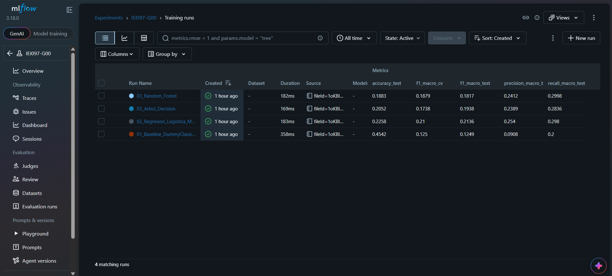
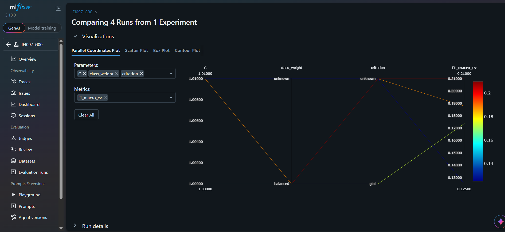
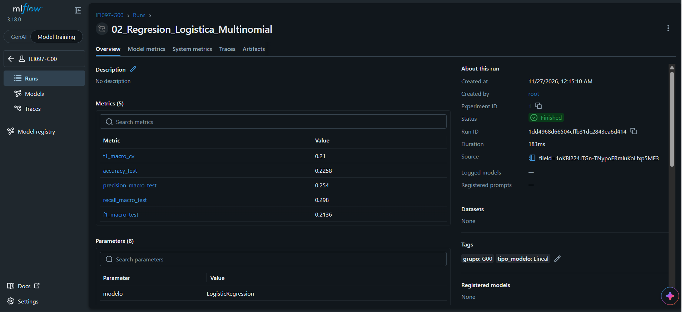

# Evaluación Final — Minería de Datos (`IEI097`)
### Clasificación Supervisada de Tramos de Carrera Docente (Evaluación Docente Chile 2024) bajo Metodología CRISP-DM

[](https://www.python.org/)
[](https://scikit-learn.org/)
[](https://mlflow.org/)
[](https://colab.research.google.com/)

---

## 1. Descripción del Proyecto
Este repositorio contiene el desarrollo completo de la evaluación final de la asignatura **Minería de Datos (`IEI097`)**, correspondiente al grupo **`IEI097-G00`**. El proyecto implementa un flujo reproducible de **clasificación supervisada multiclase** siguiendo las seis fases de la metodología **CRISP-DM**, orientado a modelar la incidencia de factores sociodemográficos, contractuales y territoriales sobre el tramo de carrera docente alcanzado (`PF_CAT_CARRERA`: categorías `A`, `B`, `C`, `D` y `E`) en el proceso de Evaluación Docente 2024 en Chile.

El desarrollo contrasta la planificación formulada en el informe previo (`IEI097_Informe_G00.pdf`, Actividad 2.13) frente a la evidencia empírica obtenida mediante validación cruzada estratificada, evaluación en conjunto de prueba independiente y trazabilidad experimental registrada en **MLflow**.

---

## 2. Estructura del Repositorio

```text
Notebook_Jupyter_Mineria_Datos_Supervisado_Clasificacion/
│
├── Evaluacion_Final_MD_Pino_Gonzalo.ipynb                 # Notebook principal (Fases 1 a 6 CRISP-DM + Decision Log)
├── IEI097_Informe_G00.pdf                                 # Informe de planificación CRISP-DM (Actividad 2.13)
├── 20251118_EVALUACION_DOCENTE_2024_20251118_PUBL.csv     # Dataset oficial MINEDUC (25.197 registros x 22 columnas)
├── evidencias_mlflow/                                     # Respaldo visual de ejecuciones y métricas en MLflow
│   ├── 01_lista_runs.png                                  # Tabla comparativa de los 4 runs en experimento IEI097-G00
│   ├── 02_comparacion_runs.png                            # Gráfico de coordenadas paralelas (hiperparámetros vs. F1-Macro CV)
│   └── 03_detalle_runs.png                                # Ficha detallada del modelo ganador (Regresión Logística Multinomial)
├── .gitignore                                             # Exclusión de artefactos temporales y entornos locales
└── README.md                                              # Documentación general del proyecto
```

---

## 3. Conjunto de Datos y Preparación (CRISP-DM)
* **Fuente:** Base de datos pública de Evaluación Docente 2024 (Ministerio de Educación de Chile), compuesta por **$25.197$ registros** y **$22$ atributos** originales (`0` registros duplicados).
* **Variable Objetivo (`PF_CAT_CARRERA`):** Clasificación multiclase de 5 tramos con desbalance severo:
  * **Tramo B:** $11.446$ docentes ($45,42\%$) — *clase mayoritaria*
  * **Tramo C:** $6.970$ docentes ($27,66\%$)
  * **Tramo D:** $3.587$ docentes ($14,24\%$)
  * **Tramo A:** $1.613$ docentes ($6,40\%$)
  * **Tramo E:** $1.581$ docentes ($6,27\%$)
* **Depuración e Ingeniería de Características:**
  * **Prevención de fuga de datos (*data leakage*):** Exclusión explícita de `PF_PJE` (puntaje de portafolio), dado que `PF_CAT_CARRERA` deriva determinísticamente de sus cortes.
  * **Limpieza estructural:** Eliminación de `PF_ESC` ($100\%$ de valores nulos), identificadores únicos (`MRUN`, `RBD`) y etiquetas textuales redundantes (`NOM_REG_RBD_A`).
  * **Tratamiento de centinelas:** Transformación de `DOC_FEC_NAC` a `EDAD` (año base $2024$), convirtiendo el código centinela `190001` (2 registros) a `NaN` para su imputación mediante mediana dentro del pipeline.
  * **Preprocesamiento sin fuga estadística:** Partición estratificada $80/20$ (`random_state=42`; $20.157$ entrenamiento / $5.040$ prueba) y encapsulamiento en `ColumnTransformer` (`SimpleImputer(strategy="median")` + `StandardScaler` para `EDAD`; `SimpleImputer(strategy="most_frequent")` + `OneHotEncoder(handle_unknown="ignore")` para las 9 variables categóricas), generando una matriz final de **$476$ características**.

---

## 4. Resultados Experimentales y Selección de Modelo
Se entrenaron cuatro modelos bajo el experimento **`IEI097-G00`**, utilizando ponderación de clases (`class_weight="balanced"`) en los algoritmos supervisados y **`F1-Macro`** como métrica guía de selección para equilibrar el desempeño entre tramos mayoritarios y minoritarios:

| Run en MLflow | Familia / Estrategia | `F1-Macro` (CV) | `F1-Macro` (Test) | `Accuracy` (Test) | `Precision-Macro` (Test) | `Recall-Macro` (Test) |
| :--- | :--- | :---: | :---: | :---: | :---: | :---: |
| **`02_Regresion_Logistica_Multinomial`** | **Lineal regularizado (`balanced`)** | **0.2100** | **0.2136** | **0.2258** | **0.2540** | 0.2980 |
| `03_Arbol_Decision` | Árbol de clasificación (`gini`, `balanced`) | 0.1738 | 0.1938 | 0.2052 | 0.2389 | 0.2836 |
| `03_Random_Forest` | Ensamble Bagging (`balanced`) | 0.1879 | 0.1817 | 0.1883 | 0.2412 | **0.2998** |
| `01_Baseline_DummyClassifier` | Línea base (`most_frequent`) | 0.1250 | 0.1249 | 0.4542* | 0.0908 | 0.2000 |

*\*Nota: El `DummyClassifier` alcanza un $45,42\%$ de exactitud global debido a que asigna el $100\%$ de las predicciones a la clase mayoritaria (`B`), obteniendo `Recall = 0.00` en los tramos `A`, `C`, `D` y `E`. Entre los modelos supervisados reales, la **Regresión Logística Multinomial** lidera en `F1-Macro` ($+71,0\%$ relativo sobre el baseline), `Precision-Macro` y `Accuracy`.*

---

## 5. Evidencias de Trazabilidad en MLflow (`IEI097-G00`)

### 5.1 Comparativa General de Ejecuciones (`Runs`)


### 5.2 Análisis Visual de Hiperparámetros y Desempeño (`Parallel Coordinates`)


### 5.3 Detalle del Modelo Seleccionado (`02_Regresion_Logistica_Multinomial`)



---

## 6. Instrucciones de Reproducibilidad
1. **Ejecución en Google Colab (recomendado):**
   * Abrir el archivo [`Evaluacion_Final_MD_Pino_Gonzalo.ipynb`](Evaluacion_Final_MD_Pino_Gonzalo.ipynb) en Google Colab.
   * Asegurar que el archivo `20251118_EVALUACION_DOCENTE_2024_20251118_PUBL.csv` se encuentre en el directorio de trabajo (`/content/`) o accesible desde la ruta configurada en la Sección 1.
   * Ejecutar secuencialmente todas las celdas (**Entorno de ejecución → Ejecutar todas**).
2. **Inspección local de la interfaz de MLflow:**
   * Para levantar la interfaz web de MLflow localmente a partir del respaldo SQLite (`mlflow.db`) y artefactos (`mlruns`):
   ```bash
   pip install mlflow==3.18.0 scikit-learn pandas numpy matplotlib seaborn
   mlflow ui --backend-store-uri sqlite:///mlflow.db --port 5000
   ```
   * Acceder desde el navegador a `[http://127.0.0.1:5000](http://127.0.0.1:5000)`, seleccionar **Model training** y abrir el experimento **`IEI097-G00`**.

---

## 7. Autoría
* **Autor:** Gonzalo Matías Pino Araya ([`@gonmpa`](https://github.com/gonmpa))
* **Grupo:** `IEI097-G00`
* **Asignatura:** Minería de Datos (`IEI097`) — Ingeniería de Ejecución en Informática, Instituto Profesional Santo Tomás
* **Fecha:** Noviembre de 2026
